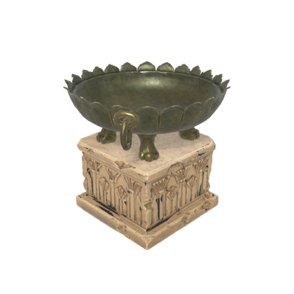

# Image-to-3D MCP Server (mcp-meshgen)

[](LICENSE)
[](https://www.rust-lang.org/)
[](https://modelcontextprotocol.io/)
[](https://enterprise.adk-rust.com)
[](https://www.zavora.ai)

Local, private **image-to-3D** over MCP: a cut-out image in, a textured GLB out, with optional previews and an engine-ready
copy (real-world size, origin at the base, FBX for Unreal). It runs open-weight models on your own machine behind a
pluggable backend interface. It was built for agents making game props on a workstation shared with Blender and Unreal
Engine: one conversion at a time, a memory check before loading, explained failures, and no surprises on disk.

The first backend runs Microsoft's **[TRELLIS.2](https://github.com/microsoft/TRELLIS.2)** (4B) on Apple Silicon through
**[trellis-mac](https://github.com/shivampkumar/trellis-mac)**. The server itself runs on **macOS, Linux and Windows**; a
backend that can't run on the current machine says why in `list_models`.

## Example

<table>
<tr>
<td align="center"><strong>input (cut-out)</strong></td>
<td align="center"><strong>preview: front</strong></td>
<td align="center"><strong>preview: three-quarter</strong></td>
</tr>
<tr>
<td></td>
<td></td>
<td></td>
</tr>
</table>

<sub>Input made with mcp-imagegen. `generate_mesh` with `previews`, `target_triangles: 20000`, `size_m: 1.2`, `fbx: true` on an
M4 (24 GB), quality 512: 20,058 triangles (3.5 M before simplification), two 1024² textures, 524 s in total (model load 90 s,
sampling 311 s, decode 73 s, bake 6 s, previews and engine copy 3 s), 13.6 GB peak resident. The engine copy measures
1.2 × 1.1 × 1.2 m with its base on the origin.</sub>

## Architecture

- **Backends** implement one trait (`availability`, `generate` with stage progress and cancel, `unload`). Each sits behind a
  Cargo feature: `trellis_mac` (default) drives a small Python worker inside trellis-mac's venv over JSON lines; `mock` is
  for tests. The worker file is embedded in the server and written to the cache dir, so the install stays one binary and
  the trellis-mac checkout stays unmodified.
- **Model registry** (`models.toml`): adding a model on an existing backend is config only. Files are checked in the Hugging
  Face cache, in the snapshot `refs/main` points at (what an offline load uses). The server **never downloads**; `list_models`
  prints the exact `hf download` command and size for anything missing, and the page to accept for gated weights.
- **Job manager**: one local lane with a bounded queue, so conversions never overlap. Each job takes a cross-process GPU lock
  (shared with sister servers), passes a free-memory check, reserves its file names, runs the backend, renames the partial
  files, runs previews and post-processing after the worker has exited, and writes a sidecar.
- **Safety**: input and output paths are jailed to configured roots (symlink and `..` escapes rejected). Files are written as
  `*.partial` and renamed only on success; cancel and failure delete them; nothing is ever overwritten. Inputs are checked
  for a real cut-out and fingerprinted (SHA-256). The model worker runs in its own process group and is killed as a tree on
  cancel or shutdown.

## Tools (5)

| Tool | Purpose | Risk |
|------|---------|------|
| `generate_mesh` | Cut-out image → GLB (+ optional OBJ, previews, engine copy). MCP Task on 2026-07-28 clients | internal_write |
| `get_job` | Status, stage progress (`loading model`, `shape 5/12`, `baking textures`) and result of a job | read_only |
| `cancel_job` | Cancel a queued or running job; the worker is stopped and no partial files are left | internal_write |
| `list_models` | Status (`ready` / `missing_files` / `needs_licence_acceptance` / `backend_unavailable`, each with the fix), every component's licence and commercial use, memory needed, typical time | read_only |
| `unload_models` | Stop a kept-alive worker to free its memory | internal_write |

`generate_mesh` parameters: `image` (required), `model`, `seed`, `quality` (`512` / `1024` / `1024_cascade`), `texture_size`,
`steps`, `output_path` (a `.glb`) or `output_dir`, `obj`, `previews`, `return_preview`, `target_triangles`, `size_m`,
`size_axis` (`longest` / `height`), `fbx`, `keep_loaded`, `wait`.

Long jobs: `generate_mesh` runs as a protocol-native **MCP Task** for clients that support them, blocks for legacy clients,
and accepts `wait: false`, which returns a `job_id` to poll with `get_job`.

Each mesh gets a sidecar `<name>.json`: model, backend, the resolved parameters (seed always included), the input's path,
size, alpha coverage and SHA-256, mesh stats read from the GLB itself (vertices, triangles, bounds, materials, texture sizes),
the engine copy's scale and bounds, stage timings, peak memory, the Mac fixes applied, warnings, every component's licence,
backend details (voxel count, faces before simplification, which baker ran) and the file names.

### Inputs must be cut out

The server only converts; it never removes backgrounds. An input without alpha, or whose alpha is nearly all opaque or
nearly all transparent, is rejected before anything loads, with the measured coverage and a pointer to an image editor
(e.g. mcp-imagegen `edit_image`). This also keeps TRELLIS's default background remover (briaai/RMBG-2.0, gated and
non-commercial) from ever being downloaded or loaded: the worker replaces it with a stub.

### Engine-ready output

- `target_triangles` sets the triangle budget **before the texture bake**, so the textures are baked onto the final low-poly
  mesh (better than decimating an already-baked mesh). trellis-mac caps it at 200k (its Metal BVH crashes above that).
- `size_m` (+ `size_axis`) or `fbx` makes an engine copy with headless Blender: scaled to real metres, origin at the bottom
  centre, transforms applied, Z up, written as `<name>_game.glb` and, with `fbx`, `<name>_game.fbx` using settings verified
  with Unreal Engine 5.8's importer (`global_scale=1.0`, `apply_unit_scale=False`, `FBX_SCALE_NONE`, forward −Z, up Y, face
  smoothing, no leaf bones, textures embedded). After importing, check the bounds: a 1 m asset reads about 100 units.
- Previews and the engine copy need Blender. Without it the mesh still succeeds and the result says they were unavailable.

## Install

```bash
git clone https://github.com/zavora-ai/mcp-meshgen && cd mcp-meshgen
cargo install --path .
```

### trellis-mac (Apple Silicon)

```bash
git clone https://github.com/shivampkumar/trellis-mac && cd trellis-mac
./setup.sh
```

Then fetch the weights with the [Hugging Face CLI](https://huggingface.co/docs/huggingface_hub/guides/cli), about 15.4 GB.
DINOv3 is gated: accept its licence on the model page first and sign in with `hf auth login`.

```bash
hf download microsoft/TRELLIS.2-4B pipeline.json ckpts/ss_flow_img_dit_1_3B_64_bf16.json ckpts/ss_flow_img_dit_1_3B_64_bf16.safetensors ckpts/shape_dec_next_dc_f16c32_fp16.json ckpts/shape_dec_next_dc_f16c32_fp16.safetensors ckpts/slat_flow_img2shape_dit_1_3B_512_bf16.json ckpts/slat_flow_img2shape_dit_1_3B_512_bf16.safetensors ckpts/slat_flow_img2shape_dit_1_3B_1024_bf16.json ckpts/slat_flow_img2shape_dit_1_3B_1024_bf16.safetensors ckpts/tex_dec_next_dc_f16c32_fp16.json ckpts/tex_dec_next_dc_f16c32_fp16.safetensors ckpts/slat_flow_imgshape2tex_dit_1_3B_512_bf16.json ckpts/slat_flow_imgshape2tex_dit_1_3B_512_bf16.safetensors ckpts/slat_flow_imgshape2tex_dit_1_3B_1024_bf16.json ckpts/slat_flow_imgshape2tex_dit_1_3B_1024_bf16.safetensors
hf download microsoft/TRELLIS-image-large ckpts/ss_dec_conv3d_16l8_fp16.json ckpts/ss_dec_conv3d_16l8_fp16.safetensors
hf download facebook/dinov3-vitl16-pretrain-lvd1689m config.json preprocessor_config.json model.safetensors
```

`list_models` always shows exactly which files are still missing, with the command for each.

### Blender (optional)

For previews and the engine copy, install [Blender](https://www.blender.org/download/) (tested with 5.2 LTS). The server
finds `blender` on `PATH`, `/Applications/Blender.app` on macOS, the newest `Blender Foundation\Blender N.N` on Windows, and
the usual Linux, snap and flatpak locations; or set `blender` in the config.

## Configure

```json
{
  "mcpServers": {
    "meshgen": {
      "type": "stdio",
      "command": "/Users/you/.cargo/bin/mcp-meshgen",
      "env": { "MCP_MESHGEN_CONFIG_DIR": "/path/to/project/.meshgen" }
    }
  }
}
```

On first run the server writes `config.toml` and `models.toml` to `$MCP_MESHGEN_CONFIG_DIR`, or by default to the platform
config dir (`~/Library/Application Support/mcp-meshgen` on macOS, `$XDG_CONFIG_HOME/mcp-meshgen` or `~/.config/mcp-meshgen`
on Linux, `%APPDATA%\mcp-meshgen` on Windows). Relative paths in the config resolve against the config dir's parent, so a
project can keep its config in `<project>/.meshgen/` and list roots like `"assets"`. See
[`config.example.toml`](config.example.toml) and [`models.example.toml`](models.example.toml). At minimum:

```toml
allowed_roots = ["assets", "generated"]      # inputs are read from, and meshes written to, only these
memory_headroom_mb = 2000

[backends.trellis_mac]
dir = "~/tools/trellis-mac"                  # the checkout; python defaults to <dir>/.venv/bin/python
```

Other keys: `default_output_dir` (empty = next to the input image), `default_model`, `hf_cache`, `blender`, `keep_loaded`,
`idle_unload_s`, `max_queue`, `job_ttl_s`, `heavy_processes` (named in memory refusals) and the `[input]` cut-out
thresholds. `MCP_MESHGEN_CACHE_DIR` overrides the cache root (tests and sandboxes; it moves the shared GPU lock too).

## Models and licences

| id | Backend | Quality | Memory | Typical time (M4) |
|---|---|---|---|---|
| `trellis2-4b` | `trellis_mac` | `512` (default), `1024`, `1024_cascade`; textures 512 / 1024 / 2048 | 15 GB resident + headroom | ~9 min with loading (quality 512) |

| Component | Licence | Commercial use |
|---|---|---|
| [TRELLIS.2](https://huggingface.co/microsoft/TRELLIS.2-4B) code and weights | MIT | yes |
| [TRELLIS sparse-structure decoder](https://huggingface.co/microsoft/TRELLIS-image-large) | MIT | yes |
| [DINOv3 image encoder](https://huggingface.co/facebook/dinov3-vitl16-pretrain-lvd1689m) (gated) | DINOv3 License | yes (royalty-free; trade-control and military-use exclusions) |
| [trellis-mac](https://github.com/shivampkumar/trellis-mac) | MIT | yes |
| briaai/RMBG-2.0 (TRELLIS's default background remover) | CC BY-NC | **never used** by this server |
| mcp-meshgen | Apache-2.0 | yes |

## Memory

TRELLIS.2 is big for a laptop: on a 24 GB M4, brazier runs peaked at 13.6–14.2 GB resident and up to 23.9 GB physical
footprint, and with every app closed macOS reports only ~16 GB available (compressible memory isn't counted), so a 24 GB Mac
needs `memory_headroom_mb` around 1000.
Before loading, the server checks that `memory_mb + memory_headroom_mb` is free and refuses rather than swapping, naming the
heavy processes it sees, e.g. *"needs ~17000 MB, 7339 MB available. Close UnrealEditor (9970 MB in 2 processes)."* On macOS
the census reads each process's physical footprint (what Activity Monitor shows), which includes GPU memory that resident
size misses. The worker exits after every job and gives the memory back; `keep_loaded` keeps it (saving ~90 s of loading)
until `unload_models` or `idle_unload_s`.

## Fixes for the Mac

Applied by the worker at load time, reported in each result's `fixes`:

- **`mps_sparse_decoder_cpu`**: on MPS (torch 2.14) TRELLIS's dense conv3d sparse-structure decoder returns one constant value
  for every voxel, in fp16 and fp32 alike, so the object decodes empty and the next stage crashes with "cannot reshape tensor
  of 0 elements". The worker runs that small (64³) decoder on the CPU in fp32; the brazier then decodes to 22,683 voxels.

Explained failures instead of tracebacks: an empty sparse structure (`empty_structure`), an empty mesh (`empty_mesh`), the
macOS GPU watchdog killing a long Metal kernel (`gpu_watchdog`, detected from Metal's message on the worker's stderr), out of
memory, missing weights, or a worker that died (with its exit signal and log tail). Each names the stage and what to try.

## Development

```bash
cargo test --all-features                     # unit, mock-backend protocol tests (MCP 2025-11-25 and 2026-07-28),
                                              # trellis_mac backend against a fake worker, Blender tests (skipped without Blender)
python -m unittest worker/test_trellis_mac_worker.py   # the Python worker's model-free parts (needs trimesh and Pillow)
MESHGEN_LIVE_TRELLIS_DIR=~/tools/trellis-mac MESHGEN_LIVE_IMAGE=/path/to/cutout.png \
  cargo test --release --test live_trellis -- --ignored --nocapture   # end to end on an Apple Silicon Mac
```

Features: `trellis_mac` (default), `mock` (the mock backend and post-processor, the `fake-worker` binary, and
`MCP_MESHGEN_MOCK_STEP_MS` / `MCP_MESHGEN_MOCK_POST` / `MCP_MESHGEN_MOCK_FAIL` for tests).

Planned: an official TRELLIS.2 backend on CUDA (Linux and Windows; same worker protocol), and a shared crate with
mcp-imagegen for the common pieces.

## License

Apache-2.0 for this server. Models and backends carry their own licences (see above); check them before shipping outputs.
